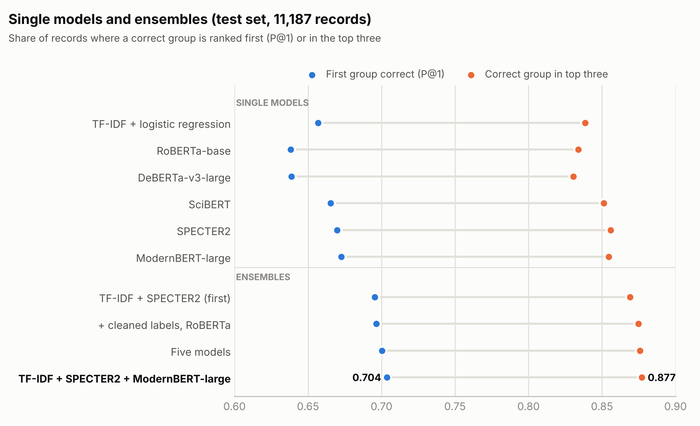
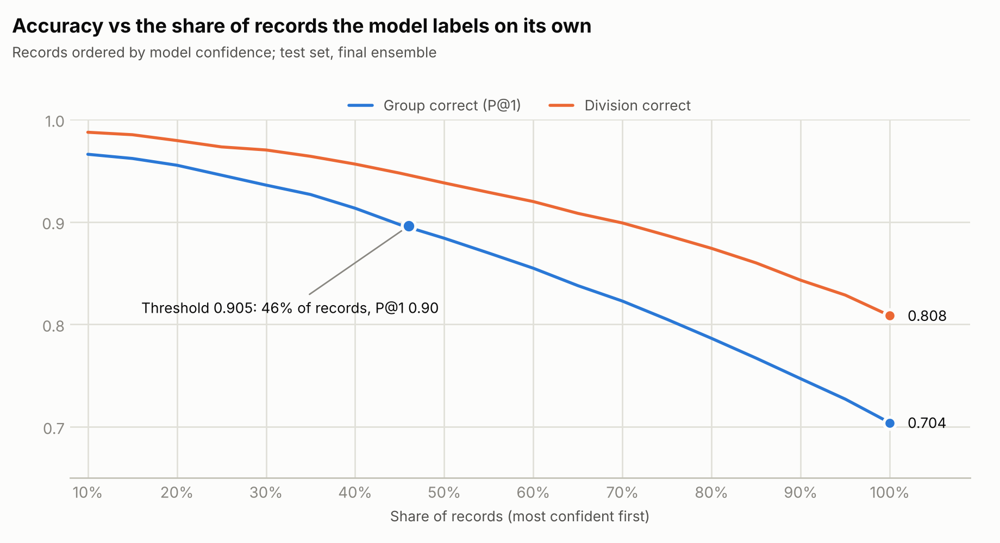
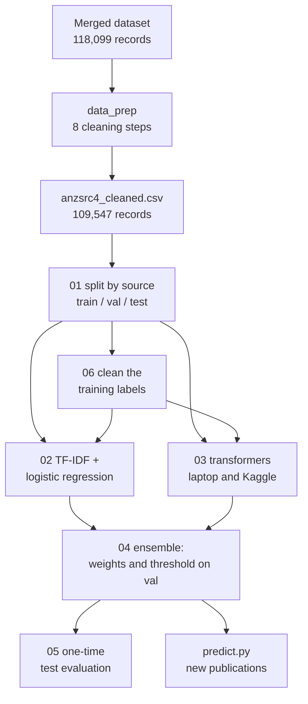

# ANZSRC FoR 2020 classifier for research publications

Assigns a research publication to groups of the Australian and New Zealand Standard Research Classification,
**ANZSRC Fields of Research 2020** (213 four-digit groups in 23 divisions), from its title and abstract alone.

**Українською:** [README.md](README.md). The detailed documentation in [docs/](docs/) is in Ukrainian; the
scripts' docstrings and code comments are in English.

## What was achieved

- **A cleaned dataset.** Eight documented cleaning steps turned 118,099 records into **109,547 publications**
  labelled with ANZSRC FoR 2020 groups: duplicates, boilerplate and misattached abstracts and non-research
  records were removed; labels were checked against the official ABS FoR 2008 → 2020 correspondence and against
  the texts themselves. Every removal or change traces back to a specific rule.
- **An honest evaluation protocol.** The data are split by source: the test set contains only journals and
  repositories the models never saw in training (no shared title, DOI or source). Weights and thresholds were
  tuned on the validation set only, out of fold.
- **Six models, from TF-IDF to large transformers.** TF-IDF + logistic regression, SciBERT, SPECTER2 and
  RoBERTa-base were trained on a laptop with a 4 GB GPU; ModernBERT-large and DeBERTa-v3-large were fully
  fine-tuned on free Kaggle GPUs (2 × T4).
- **Cleaner training labels.** Journal-wide codes that the articles' texts do not support were removed from
  the training set: labels changed in 933 records, 916 records excluded.
- **The final model** combines TF-IDF + SPECTER2 + ModernBERT-large. On the test set (11,187 records):
  - the first suggested group is correct for **70.4 %** of records (95 % CI 67.6–72.9 %), 3.1 points above the
    best single model;
  - a correct group is among the top three for **87.7 %**, among the top five for **92.6 %**;
  - the division (first two digits) is correct for **80.8 %**, within the top two for **92.4 %**.
- **Confidence mode.** For **46 %** of records the model assigns a group with **89.6 %** precision; the rest can
  go to a person with three candidates (a correct one among them in 80 % of cases).
- **Understanding the ceiling.** A manual review of disagreements and blind comparisons of systems showed that
  most "errors" are neighbouring groups, "Other …" codes or imprecise labels: accuracy measured against these
  labels is unlikely to exceed ~80 %.
- **A ready-to-use tool.** [`predict.py`](training/predict.py) adds groups, their names, divisions, the five most
  probable groups and the model's confidence to a CSV or Excel file of new publications.

## Results

<picture>
  <source media="(prefers-color-scheme: dark)" srcset="docs/img/models_en_dark.png">
  
</picture>

| Final ensemble | test | validation, out of fold |
|---|---:|---:|
| First group correct (P@1) | **0.704** | 0.708 |
| … counting any group of the same division as correct for an "Other …" (XX99) label | 0.731 | 0.737 |
| Correct group in top 3 | **0.877** | 0.872 |
| Correct group in top 5 | 0.926 | 0.928 |
| micro-F1 / macro-F1 (selected set of groups) | 0.642 / 0.623 | 0.644 / 0.617 |
| macro-AP | 0.659 | 0.660 |
| Division: first correct / within top two | **0.808** / 0.924 | 0.818 / 0.926 |

<picture>
  <source media="(prefers-color-scheme: dark)" srcset="docs/img/coverage_en_dark.png">
  
</picture>

| Single model (test) | Training labels | P@1 | Top-3 | micro-F1 | macro-F1 |
|---|---|---:|---:|---:|---:|
| TF-IDF + logistic regression | cleaned | 0.657 | 0.839 | 0.601 | 0.575 |
| SciBERT | original | 0.665 | 0.851 | 0.597 | 0.580 |
| SPECTER2 | cleaned | 0.670 | 0.856 | 0.603 | 0.585 |
| RoBERTa-base | cleaned | 0.638 | 0.834 | 0.573 | 0.557 |
| DeBERTa-v3-large | cleaned | 0.639 | 0.831 | 0.574 | 0.559 |
| ModernBERT-large | cleaned | 0.673 | 0.855 | 0.606 | 0.592 |
| **Ensemble TF-IDF + SPECTER2 + ModernBERT-large** | cleaned | **0.704** | **0.877** | **0.642** | **0.623** |

All experiments, confidence intervals, per-group and per-origin results and the manual reviews:
[docs/results.md](docs/results.md).

## How it works



1. **Data** ([docs/data.md](docs/data.md)): duplicates, shared and empty abstracts, non-research records,
   labels, FoR 2008 codes, language, near-identical texts, labels the text does not support.
2. **Split** by journal, DOI prefix and repository (80 / 10 / 10), stratified over the 213 groups.
3. **Models** ([docs/method.md](docs/method.md)): TF-IDF + logistic regression and five transformer encoders
   with a linear layer over `[CLS]`, binary cross-entropy with rare groups up-weighted.
4. **Ensemble:** weighted mean of log-odds; weights and one shared threshold chosen by cross-validation
   within the validation set.
5. **Evaluation:** the test set once per system; source-level bootstrap; results by record origin.

## Quick start

```bash
git clone https://github.com/Yaroslavandds/anzsrc-for-classifier.git
cd anzsrc-for-classifier
python training/00_check_env.py       # prints the PyTorch install command for your GPU
pip install -r requirements.txt
```

The dataset and the trained models are not in the repository (220 MB of data with third-party abstracts;
several GB of models). To reproduce the work, put the dataset in the repository root as `anzsrc4_cleaned.csv`
(or build it from the source data with [data_prep/](data_prep/)) and run [training/](training/):

```bat
cd training
python 01_split.py
python 06_clean_labels.py
python 02_baseline.py --train train_clean
python 03_train_transformer.py --train train_clean
python 03_train_transformer.py --model answerdotai/ModernBERT-large --train train_clean --batch 16 --lr 2e-5
python 04_ensemble.py --models baseline_clean specter2_clean modernbert_large_clean --name ensemble_final
python 05_evaluate.py --ensemble ensemble_final
python predict.py --input new_papers.xlsx --output predictions.xlsx
```

The large model needs a GPU with roughly 10 GB or more; otherwise use Kaggle or LoRA on 4 GB. Step-by-step
instructions, training times and all options: [training/README.md](training/README.md).

## Repository layout

```
anzsrc-for-classifier/
├── anzsrc2020_for.xlsx    group and division names (ABS, CC BY 4.0)
├── requirements.txt
├── data_prep/             eight data-cleaning steps and the FoR 2008 → 2020 correspondence
├── training/              split, models, ensemble, evaluation, prediction, Kaggle notebook
└── docs/
    ├── data.md            data, fields, cleaning, label caveats
    ├── method.md          split, models, training, ensemble, evaluation, hardware
    ├── results.md         all results, manual reviews, conclusions
    ├── img/               charts (light and dark)
    └── results/           JSON reports written by the scripts
```

## Limitations

- **Noisy labels.** Some codes are journal-wide or assigned automatically by repositories; the clearest cases
  were removed, but labelling conventions remain in both training and test data. A blind review found no gain in
  content from the last improvements: the metric gains mostly reflect closer agreement with these conventions.
- **Rare groups.** The Indigenous studies groups (45xx) have few examples: 4517 has 6 records, 4506 has 69.
- **Newer material types** (theses, datasets, grants): P@1 0.59–0.61 versus 0.73 for journal articles of the
  original dataset.
- **English only**; an abstract is required.
- **The manual reviews** were done by an AI assistant (Claude) as a single reviewer: estimates, not an expert
  gold standard.
- The composition of the final ensemble was chosen after several variants had been scored on the test set
  (within 0.4 points of each other), so its test numbers may be slightly optimistic; the out-of-fold validation
  estimate is the same (P@1 0.708).

## Licence

Code and documentation: [MIT](LICENSE). ABS files (`anzsrc2020_for.xlsx`,
`data_prep/anzsrc_for2008_to_2020_ABS.csv`): © Australian Bureau of Statistics,
[CC BY 4.0](https://creativecommons.org/licenses/by/4.0/). The dataset is not distributed.

## Author

Yaroslav Korkos, 2026. How to cite: [CITATION.cff](CITATION.cff).
