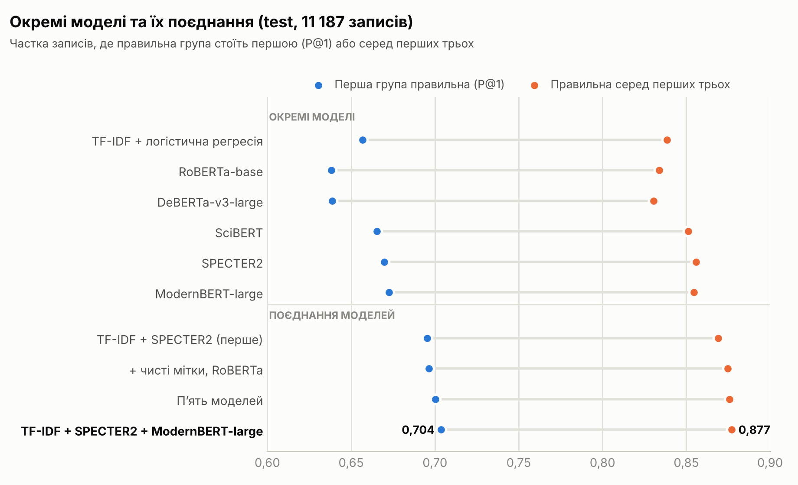
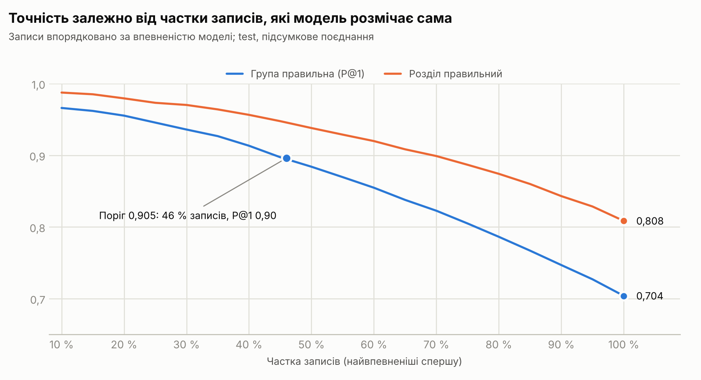
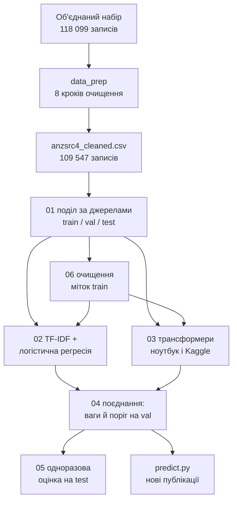

# Класифікатор наукових публікацій за ANZSRC FoR 2020

Визначає, до яких груп австралійсько-новозеландської класифікації галузей досліджень
**ANZSRC Fields of Research 2020** (213 чотиризначних груп у 23 розділах) належить публікація, — лише за її
назвою та анотацією.

**English version:** [README.en.md](README.en.md)

## Що досягнуто

- З 118 099 записів після очищення лишилося **109 547 публікацій** з мітками ANZSRC FoR 2020: прибрано дублікати, шаблонні й чужі анотації, службові
  записи; мітки звірено з офіційною таблицею відповідності ABS (FoR 2008 → 2020) і з самими текстами. Кожне
  видалення чи правку можна відстежити до конкретного правила.
- **Чесна схема перевірки.** Дані поділено за джерелами: у test лише журнали й репозиторії, яких моделі не
  бачили під час навчання (жодної спільної назви, DOI чи джерела). Ваги й пороги підібрано тільки на val,
  позафолдово.
- **Шість моделей — від TF-IDF до великих трансформерів.** TF-IDF + логістична регресія, SciBERT, SPECTER2,
  RoBERTa-base навчено на ноутбуці з відеокартою 4 ГБ; ModernBERT-large і DeBERTa-v3-large — повністю донавчено
  на безкоштовних відеокартах Kaggle (2 × T4).
- **Очищення міток для навчання.** У train знято коди, які журнали ставлять усім статтям, хоч тексти їх не
  підтримують: мітки змінено в 933 записах, 916 записів виключено.
- **Підсумкова модель** — поєднання TF-IDF + SPECTER2 + ModernBERT-large. На test (11 187 записів):
  - перша запропонована група правильна у **70,4 %** записів (95 % ДІ 67,6–72,9 %), на 3,1 пункту краще за
    найкращу окрему модель;
  - правильна група серед трьох перших — у **87,7 %**, серед п'яти — у **92,6 %**;
  - розділ (дві перші цифри коду) правильний у **80,8 %**, серед двох перших — у **92,4 %**.
- **Режим впевненості.** Для **46 %** записів модель визначає групу з точністю **89,6 %**; решту можна
  передати людині з трьома кандидатами (правильний серед них — у 80 %).
- **Аналіз меж.** Ручна перевірка розбіжностей і сліпі порівняння систем показали, що більшість «помилок» —
  сусідні групи, «Other …» або неточні мітки: за мітками виміряна точність навряд чи перевищить ~80 %.
- **Готовий інструмент.** [`predict.py`](training/predict.py) додає до CSV чи Excel з новими публікаціями групи,
  їхні назви, розділи, п'ять найімовірніших варіантів і впевненість моделі.

## Результати

<picture>
  <source media="(prefers-color-scheme: dark)" srcset="docs/img/models_uk_dark.png">
  
</picture>

| Підсумкове поєднання | test | val, позафолдово |
|---|---:|---:|
| Перша група правильна (P@1) | **0,704** | 0,708 |
| … якщо «Other …» (XX99) зараховує групу того самого розділу | 0,731 | 0,737 |
| Правильна група серед 3 перших | **0,877** | 0,872 |
| Правильна група серед 5 перших | 0,926 | 0,928 |
| micro-F1 / macro-F1 (вибраний набір груп) | 0,642 / 0,623 | 0,644 / 0,617 |
| macro-AP | 0,659 | 0,660 |
| Розділ: перший правильний / серед двох перших | **0,808** / 0,924 | 0,818 / 0,926 |

<picture>
  <source media="(prefers-color-scheme: dark)" srcset="docs/img/coverage_uk_dark.png">
  
</picture>

| Окрема модель (test) | Мітки train | P@1 | Топ-3 | micro-F1 | macro-F1 |
|---|---|---:|---:|---:|---:|
| TF-IDF + логістична регресія | очищені | 0,657 | 0,839 | 0,601 | 0,575 |
| SciBERT | вихідні | 0,665 | 0,851 | 0,597 | 0,580 |
| SPECTER2 | очищені | 0,670 | 0,856 | 0,603 | 0,585 |
| RoBERTa-base | очищені | 0,638 | 0,834 | 0,573 | 0,557 |
| DeBERTa-v3-large | очищені | 0,639 | 0,831 | 0,574 | 0,559 |
| ModernBERT-large | очищені | 0,673 | 0,855 | 0,606 | 0,592 |
| **Поєднання TF-IDF + SPECTER2 + ModernBERT-large** | очищені | **0,704** | **0,877** | **0,642** | **0,623** |

Усі експерименти, довірчі інтервали, результати за групами й за походженням записів, ручні перевірки —
у [docs/results.md](docs/results.md).

## Як це працює



1. **Дані** ([docs/data.md](docs/data.md)): вісім кроків очищення — дублікати, спільні й порожні анотації,
   службові записи, мітки, коди FoR 2008, мова, майже однакові тексти, мітки, яких не підтримує текст.
2. **Поділ** за журналами, префіксами DOI і репозиторіями (80 / 10 / 10), стратифікований за 213 групами.
3. **Моделі** ([docs/method.md](docs/method.md)): TF-IDF + логістична регресія і п'ять трансформерів з лінійним
   шаром над `[CLS]`, бінарна крос-ентропія зі зваженими рідкісними групами.
4. **Поєднання:** зважене середнє логарифмів шансів; ваги й спільний поріг — перехресною перевіркою всередині val.
5. **Оцінка:** test — один раз для кожної системи; бутстреп за джерелами; розбивка за походженням запису.

## Швидкий старт

```bash
git clone https://github.com/Yaroslavandds/anzsrc-for-classifier.git
cd anzsrc-for-classifier
python training/00_check_env.py       # підкаже команду встановлення PyTorch під вашу відеокарту
pip install -r requirements.txt
```

Набору даних і навчених моделей у репозиторії немає (220 МБ даних з чужими анотаціями; моделі — кілька
гігабайтів). Щоб відтворити роботу, покладіть набір у корінь як `anzsrc4_cleaned.csv` (або зберіть його з
вихідних даних скриптами [data_prep/](data_prep/)) і запустіть кроки з [training/](training/):

```bat
cd training
python 01_split.py
python 06_clean_labels.py
python 02_baseline.py --train train_clean
python 03_train_transformer.py --train train_clean
python 03_train_transformer.py --model answerdotai/ModernBERT-large --train train_clean --batch 16 --lr 2e-5
python 04_ensemble.py --models baseline_clean specter2_clean modernbert_large_clean --name ensemble_final
python 05_evaluate.py --ensemble ensemble_final
python predict.py --input new_papers.xlsx --output predictions.xlsx
```

Великій моделі потрібна відеокарта приблизно на 10 ГБ і більше; інакше — Kaggle або LoRA на 4 ГБ.
Покрокова інструкція, час навчання й усі параметри — у [training/README.md](training/README.md).

## Структура

```
anzsrc-for-classifier/
├── anzsrc2020_for.xlsx    назви груп і розділів (ABS, CC BY 4.0)
├── requirements.txt
├── data_prep/             вісім кроків очищення даних і таблиця відповідності FoR 2008 → 2020
├── training/              поділ, моделі, поєднання, оцінка, передбачення, ноутбук Kaggle
└── docs/
    ├── data.md            дані, поля, очищення, особливості міток
    ├── method.md          поділ, моделі, навчання, поєднання, оцінка, обладнання
    ├── results.md         усі результати, ручні перевірки, висновки
    ├── img/               графіки (світла й темна теми)
    └── results/           JSON-звіти скриптів
```

## Обмеження

- **Мітки неточні.** Частина кодів — журнальні або поставлені репозиторіями автоматично; найпомітніші випадки
  знято, але конвенції розмітки лишаються і в train, і в test. Сліпа перевірка не виявила змістового
  покращення від останніх кроків: приріст метрик здебільшого означає краще відтворення цих конвенцій.
- **Рідкісні групи.** Групи корінних студій (45xx) мають мало прикладів: 4517 — 6 записів, 4506 — 69.
- **Нові типи матеріалів** (дисертації, набори даних, гранти): P@1 0,59–0,61 проти 0,73 для журнальних статей
  вихідного набору.
- **Лише англійська мова**, потрібна анотація.
- **Ручні перевірки** виконував один рецензент — ШІ-асистент Claude, тож це оцінки, а не експертний еталон.
- Склад підсумкового поєднання вибрано після вимірювання кількох варіантів на test (різниця між ними
  ≤ 0,4 пункту), тож його цифри на test можуть бути трохи оптимістичними; позафолдова оцінка на val
  така сама (P@1 0,708).

## Ліцензія

Код і документація — [MIT](LICENSE). Файли ABS (`anzsrc2020_for.xlsx`,
`data_prep/anzsrc_for2008_to_2020_ABS.csv`) — © Australian Bureau of Statistics,
[CC BY 4.0](https://creativecommons.org/licenses/by/4.0/). Набір даних не поширюється.

## Автор

Yaroslav Korkos, 2026. Як цитувати — у [CITATION.cff](CITATION.cff).
