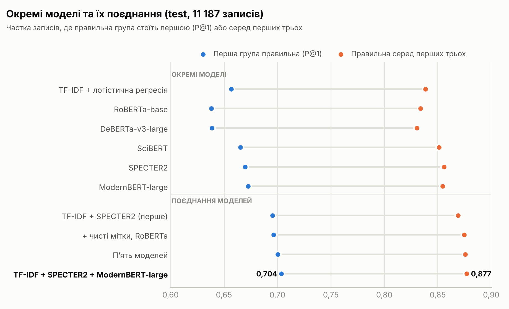
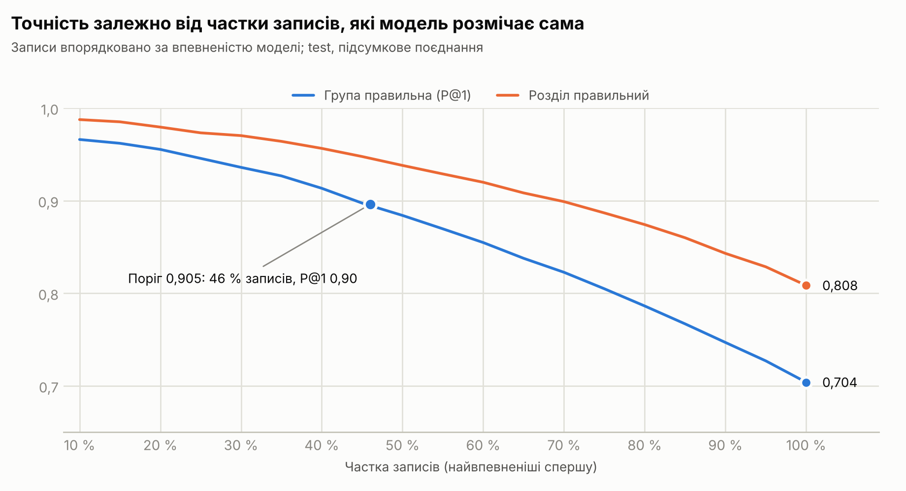

# Результати

Усі цифри — на **test**: 11 187 записів з 1 788 джерел, яких моделі під час навчання не бачили (якщо не
сказано інше). Повні звіти скриптів — JSON у [results/](results/); визначення метрик — у
[method.md](method.md#метрики).

## Підсумкове поєднання

TF-IDF + SPECTER2 + ModernBERT-large (ваги 0,3 / 0,3 / 0,4), поріг 0,40.

| Метрика | test | 95 % ДІ | val, позафолдово |
|---|---:|---:|---:|
| **P@1** (перша група правильна) | **0,704** | 0,676–0,729 | 0,708 |
| P@1 «Інше» | 0,731 | | 0,737 |
| **топ-3** | **0,877** | 0,861–0,892 | 0,872 |
| топ-5 | 0,926 | | 0,928 |
| micro-F1 | 0,642 | | 0,644 |
| macro-F1 | 0,623 | | 0,617 |
| samples-F1 | 0,630 | | 0,631 |
| macro-AP | 0,659 | | 0,660 |
| **Розділ: P@1** | **0,808** | | 0,818 |
| Розділ: серед двох перших | 0,924 | | 0,926 |
| Розділ: micro-F1 | 0,750 | | 0,755 |
| Груп на запис: передбачено / в мітках | 1,76 / 1,73 | | 1,76 / 1,72 |

Test і незалежна від нього позафолдова оцінка на val майже збігаються. Довірчий інтервал широкий (близько ±2,7
відсоткового пункту), бо джерела в test дуже різні за складністю, а бутстреп вибирає цілі джерела. Різниці між
системами на тих самих записах виміряно значно точніше (див. нижче).

### За походженням запису

| Походження | Записів | Міток на запис | P@1 | P@1 «Інше» | топ-3 | топ-5 | Розділ P@1 | micro-F1 | macro-F1 |
|---|---:|---:|---:|---:|---:|---:|---:|---:|---:|
| `original` | 8 879 | 1,62 | 0,730 | 0,732 | 0,890 | 0,931 | 0,809 | 0,691 | 0,613 |
| `new` | 1 116 | 2,13 | 0,594 | 0,726 | 0,834 | 0,921 | 0,798 | 0,481 | 0,304 |
| `new_material` | 1 192 | 2,14 | 0,609 | 0,729 | 0,825 | 0,894 | 0,817 | 0,502 | 0,305 |

У нових записах P@1 нижча, але поблажлива P@1 «Інше» майже та сама, що й для `original`: репозиторії часто
ставлять «Other …» (XX99), а модель обирає конкретну групу того самого розділу. Точність розділу однакова для
всіх трьох (0,80–0,82).

## Окремі моделі

<picture>
  <source media="(prefers-color-scheme: dark)" srcset="img/models_uk_dark.png">
  
</picture>

| Модель | Мітки train | P@1 | топ-3 | топ-5 | micro-F1 | macro-F1 | macro-AP | Розділ P@1 |
|---|---|---:|---:|---:|---:|---:|---:|---:|
| TF-IDF + логістична регресія | вихідні | 0,656 | 0,836 | 0,893 | 0,598 | 0,573 | 0,584 | 0,767 |
| TF-IDF + логістична регресія | очищені | 0,657 | 0,839 | 0,894 | 0,601 | 0,575 | 0,587 | 0,768 |
| SciBERT | вихідні | 0,665 | 0,851 | 0,909 | 0,597 | 0,580 | 0,601 | 0,790 |
| SPECTER2 | вихідні | 0,668 | 0,854 | 0,911 | 0,600 | 0,584 | 0,602 | 0,790 |
| SPECTER2 | очищені | 0,670 | 0,856 | 0,915 | 0,603 | 0,585 | 0,605 | 0,796 |
| RoBERTa-base | очищені | 0,638 | 0,834 | 0,895 | 0,573 | 0,557 | 0,571 | 0,775 |
| DeBERTa-v3-large | очищені | 0,639 | 0,831 | 0,894 | 0,574 | 0,559 | 0,570 | 0,781 |
| ModernBERT-large | очищені | **0,673** | 0,855 | 0,909 | **0,606** | **0,592** | **0,614** | 0,791 |

* Окремі моделі лежать у вузькому діапазоні P@1 0,638–0,673. Наукові моделі (SPECTER2, SciBERT) на 3 пункти
  кращі за загальну RoBERTa-base того самого розміру.
* Велика ModernBERT-large (395 млн параметрів) лише на 0,3 пункту P@1 краща за SPECTER2 (110 млн).
* DeBERTa-v3-large відстає: її метрики на val найшвидше зростали ще на третій епосі (ймовірно, недонавчена),
  а на T4 вона навчалась у fp16.
* Простий TF-IDF (0,657) майже не поступається трансформерам і добре їх доповнює: у підсумковому поєднанні
  його вага 0,3.

## Як зростав результат

| Етап | Склад поєднання | P@1 | P@1 «Інше» | топ-3 | топ-5 | micro-F1 | macro-F1 | macro-AP | Розділ P@1 |
|---|---|---:|---:|---:|---:|---:|---:|---:|---:|
| 1. Перше поєднання | TF-IDF + SPECTER2, вихідні мітки | 0,696 | 0,726 | 0,869 | 0,923 | 0,636 | 0,613 | 0,644 | 0,802 |
| 2. Очищені мітки | TF-IDF + SPECTER2 + RoBERTa-base | 0,697 | 0,727 | 0,875 | 0,924 | 0,637 | 0,613 | 0,648 | 0,804 |
| 3. Великі моделі | п'ять моделей: етап 2 + ModernBERT-large + DeBERTa-v3-large | 0,700 | 0,729 | 0,876 | 0,924 | 0,641 | 0,621 | 0,657 | 0,807 |
| 4. **Підсумкове** | TF-IDF + SPECTER2 + ModernBERT-large | **0,704** | **0,731** | **0,877** | **0,926** | **0,642** | **0,623** | **0,659** | **0,808** |

### Наскільки надійні різниці

Парний бутстреп за джерелами (2 000 повторів), різниця підсумкового поєднання з іншою системою, у відсоткових
пунктах, з 95 % довірчим інтервалом:

| Порівняно з | P@1 | топ-3 |
|---|---:|---:|
| найкраща окрема модель (ModernBERT-large) | +3,1 [2,2; 4,0] | +2,3 [1,7; 2,8] |
| SPECTER2 | +3,4 [2,8; 4,1] | +2,1 [1,6; 2,6] |
| TF-IDF | +4,7 [3,9; 5,7] | +3,9 [2,9; 5,1] |
| перше поєднання (етап 1) | +0,8 [0,2; 1,5] | +0,8 [0,3; 1,3] |
| п'ять моделей (етап 3) | +0,4 [0,0; 0,7] | +0,1 [−0,2; 0,4] |

Поєднання різних моделей дає надійні +3 пункти над найкращою окремою. Подальші кроки (очищення міток, великі
моделі) додали менше пункту, і сліпа ручна перевірка змістового покращення не виявила (див.
[Ручні перевірки](#ручні-перевірки)). Склад підсумкового поєднання вибрано після вимірювання кількох
варіантів на test, тож його перевага над п'ятьма моделями може бути трохи завищеною
([method.md](method.md#поєднання-моделей-04_ensemblepy)).

## Режим впевненості

<picture>
  <source media="(prefers-color-scheme: dark)" srcset="img/coverage_uk_dark.png">
  
</picture>

Записи впорядковано за найбільшою ймовірністю, яку дає модель. Поріг підібрано на val, перевірено на test:

| Поріг на найбільшу ймовірність | Ціль на val | Частка записів test | P@1 серед них | Решта: топ-3 | Решта: топ-5 |
|---|---|---:|---:|---:|---:|
| 0,905 | P@1 ≥ 0,90 | **46,0 %** | **0,896** | 0,801 | 0,877 |
| 0,98 | P@1 ≥ 0,95 | 20,9 % | 0,951 | 0,850 | 0,908 |

Тобто майже половину записів модель може розмічати сама з точністю ~90 %, а для решти дає людині три
кандидати, серед яких правильний у 80 % випадків.

| Найвпевненіші | 10 % | 20 % | 30 % | 40 % | 50 % | 60 % | 70 % | 80 % | 90 % | 100 % |
|---|---:|---:|---:|---:|---:|---:|---:|---:|---:|---:|
| P@1 | 0,966 | 0,955 | 0,936 | 0,913 | 0,884 | 0,855 | 0,823 | 0,786 | 0,747 | 0,704 |
| P@1 «Інше» | 0,985 | 0,973 | 0,957 | 0,936 | 0,908 | 0,880 | 0,850 | 0,814 | 0,775 | 0,731 |
| Розділ P@1 | 0,988 | 0,979 | 0,970 | 0,956 | 0,938 | 0,920 | 0,899 | 0,874 | 0,843 | 0,808 |
| топ-3 | 0,984 | 0,984 | 0,976 | 0,969 | 0,964 | 0,957 | 0,945 | 0,929 | 0,905 | 0,877 |

## Рівно k кандидатів

| k | Правильна серед k | Частка правильних серед k | Знайдено міток (recall) |
|---:|---:|---:|---:|
| 1 | 0,704 | 0,704 | 0,408 |
| 2 | 0,821 | 0,551 | 0,639 |
| 3 | 0,877 | 0,435 | 0,757 |
| 5 | 0,926 | 0,292 | 0,846 |

## За групами

Медіанний F1 по 213 групах — 0,63; F1 ≥ 0,70 мають 72 групи, F1 ≥ 0,50 — 177.

| Найкращі (≥ 30 записів у test) | F1 | | Найслабші (≥ 30 записів у test) | F1 |
|---|---:|---|---|---:|
| 3003 Animal production | 0,88 | | 4601 Applied computing | 0,00 |
| 3302 Building | 0,88 | | 3303 Design | 0,15 |
| 3405 Organic chemistry | 0,87 | | 3301 Architecture | 0,27 |
| 4510 Te hauora me te oranga o te Māori (Māori health and wellbeing) | 0,86 | | 5203 Clinical and health psychology | 0,29 |
| 3502 Banking, finance and investment | 0,86 | | 3904 Specialist studies in education | 0,31 |
| 4019 Resources engineering and extractive metallurgy | 0,86 | | 5205 Social and personality psychology | 0,33 |
| 4604 Cybersecurity and privacy | 0,85 | | 3205 Medical biochemistry and metabolomics | 0,33 |
| 3212 Ophthalmology and optometry | 0,84 | | 4407 Policy and administration | 0,36 |

Найслабші — широкі й міждисциплінарні групи, зміст яких перетинається з іншими (дизайн, прикладні обчислення,
підгалузі психології, політика). Найчастіші сплутування (мітка → перша група моделі):

| Мітка | Модель | Записів |
|---|---|---:|
| 3699 Other creative arts and writing | 3606 Visual arts | 16 |
| 3599 Other commerce, management, tourism and services | 3508 Tourism | 15 |
| 3404 Medicinal and biomolecular chemistry | 3101 Biochemistry and cell biology | 14 |
| 3004 Crop and pasture production | 4103 Environmental biotechnology | 13 |
| 3101 Biochemistry and cell biology | 3208 Medical physiology | 12 |
| 3004 Crop and pasture production | 3001 Agricultural biotechnology | 11 |

Здебільшого це сусідні групи або «Other …» проти конкретної групи того самого розділу.

## Ручні перевірки

> Усі ручні перевірки виконав ШІ-асистент Claude: читав назву й анотацію і вирішував, яка група підходить.
> Це один рецензент, не експерт-предметник, і до сусідніх груп він доволі поблажливий; цифри нижче — оцінки,
> а не еталон.

**«Помилки» на val.** 100 випадкових записів val, де перша група першого поєднання (TF-IDF + SPECTER2) не
збігається з жодною міткою:

| Вердикт | Записів |
|---|---:|
| група моделі підходить до тексту так само добре або краще за мітку | 42 |
| обидва варіанти можна обґрунтувати (зазвичай сусідні групи) | 41 |
| модель помилилась | 17 |

Якщо перенести на весь val (P@1 цієї системи — 0,695): перша група підходить до тексту приблизно у 82 % записів
у строгому сенсі й прийнятна приблизно в 95 %; справжніх помилок — близько 5 % (похибка вибірки ±2–3 пункти).
Звідси оцінка стелі: за міткою виміряна P@1 навряд чи перевищить ~80 %, навіть якщо модель вибиратиме
змістово правильно.

**Кандидати на виправлення міток** (крок 6 навчання, рівень записів). Із 40 переглянутих: у 62,5 % мітка справді
не відповідала тексту, у 27,5 % прийнятні обидва варіанти, у 10 % мітка була правильною. Тому мітки лише
знімались і тільки за суворих порогів.

**Сліпі порівняння на test.** По 100 записів, де перші групи двох систем різні (а з міткою збігається
щонайбільше одна з них). Рецензент не знав, яка відповідь чия.

| Порівняння | Краща нова | Краща попередня | Однаково | Прийнятна: попередня / нова | Збіг із міткою: попередня / нова |
|---|---:|---:|---:|---:|---:|
| етап 1 → етап 2 (очищені мітки) | 28 | 27 | 45 | 72 % / 75 % | 37 / 23 |
| етап 2 → підсумкове | 30 | 35 | 35 | 80 % / 70 % | 28 / 40 |

За змістом жодна система не виявилась помітно кращою. Перше порівняння: модель на очищених мітках рідше
збігається зі спірними мітками test, хоча за змістом не гірша. Друге: підсумкове поєднання частіше збігається з
мітками (40 проти 28), але змістово не краще (30 проти 35 — в межах шуму). Тобто приріст метрик на етапах 2–4
здебільшого означає краще відтворення конвенцій розмітки, а не точніше розуміння текстів.

## Висновки

1. **~70 % P@1 і 88 % топ-3 на нових джерелах** — результат, близький до того, що дозволяють виміряти мітки:
   більшість розбіжностей — сусідні групи, «Other …» або неточні мітки.
2. **Поєднання різнотипних моделей** (розріджений TF-IDF + науковий трансформер + великий загальний
   трансформер) дає +3 пункти над найкращою окремою моделлю; більша модель сама по собі — лише +0,3.
3. **Для практики** найкорисніший режим впевненості: 46 % записів автоматично з точністю ~90 %, для решти —
   три кандидати.
4. **Що могло б допомогти далі:** більше даних для рідкісних груп (корінні студії 45xx), перегляд спірних міток
   експертами, ключові слова чи повний текст, ієрархічна модель «розділ → група», публікація моделей на
   Hugging Face Hub.
